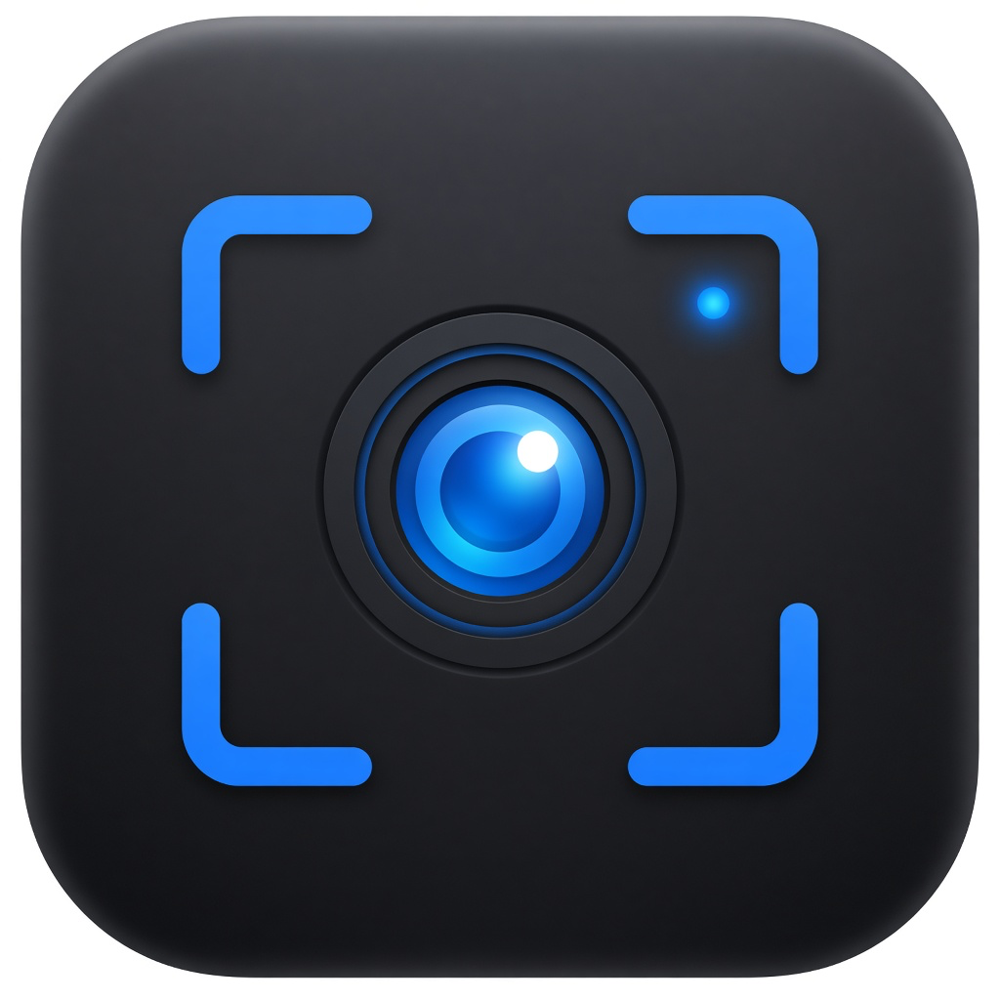
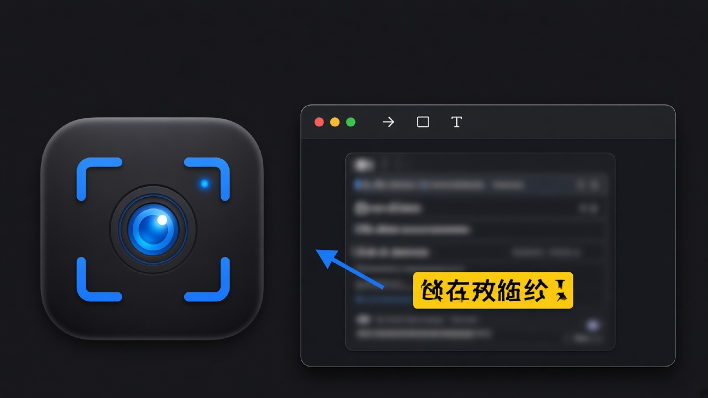
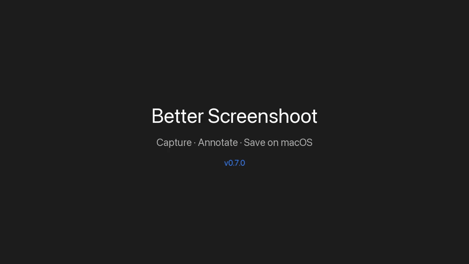
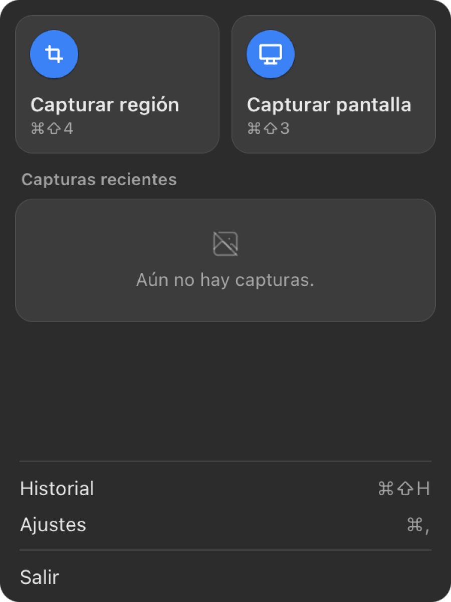
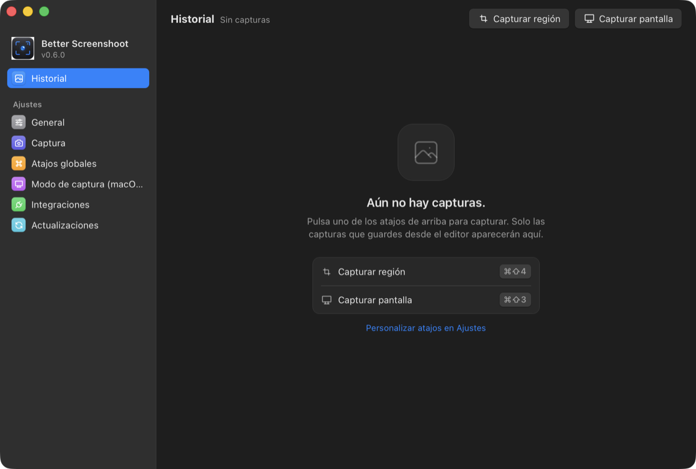
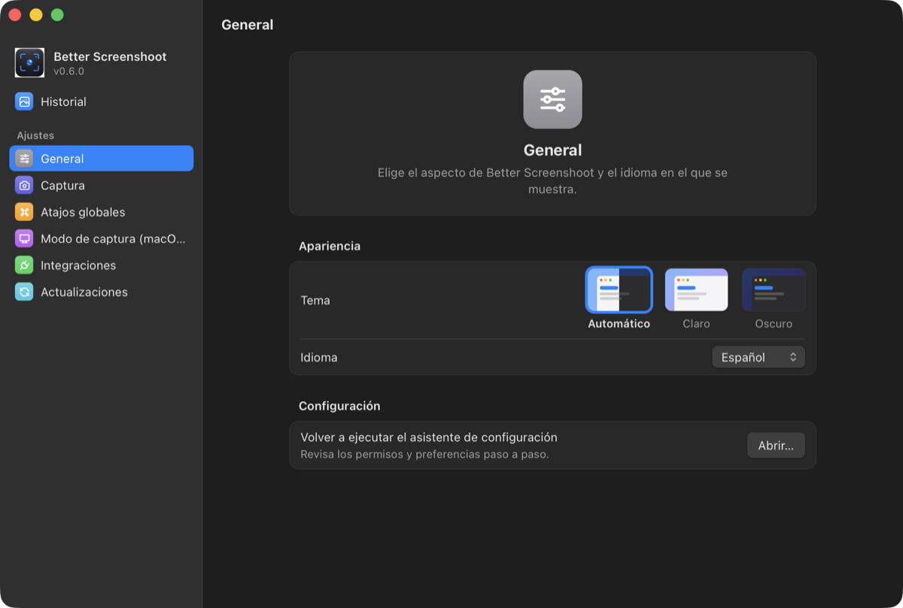

<p align="center">
  
</p>

<h1 align="center">Better Screenshoot</h1>

<p align="center">
  <strong>Screenshots with a built-in editor, global shortcuts, and history.</strong><br>
  macOS only · lives in the menu bar · annotate and share in seconds.
</p>

<p align="center">
  <a href="#install"></a>
  <a href="#install"></a>
  <a href="https://github.com/sriverogalan/better-screenshoot/issues/new/choose"></a>
</p>

<p align="center">
  
</p>

---

## Demo

<p align="center">
  
</p>

<details>
<summary>MP4 version (smaller download)</summary>

[Download demo.mp4](docs/assets/demo.mp4)

</details>

## Install

```sh
brew install --cask sriverogalan/tap/better-screenshoot
```

Uninstall:

```sh
brew uninstall --cask better-screenshoot
```

> **Requirements:** macOS 12.0 (Monterey) or later · **Screen Recording** permission (the app walks you through it on first launch).

## Features

| | |
|---|---|
| **Fast capture** | Region or full screen from the menu bar or global shortcuts. |
| **Instant editor** | Arrows, rectangles, text, highlight, freehand, and blur. |
| **History** | Keep what matters and reopen it later. |
| **Your shortcuts** | Remap hotkeys in Settings — optionally replace macOS system captures. |

## Screenshots

<p align="center">
  
  &nbsp;
  
</p>

<p align="center">
  
</p>

## Default shortcuts

| Action | Shortcut |
|---|---|
| Capture region | ⌘⇧X |
| Capture screen | ⌘⇧⌥S |
| Open history | ⌘⇧H |

Change them anytime in **Settings → Global shortcuts**.

## Found a bug? Open an issue

We care about real multi-monitor setups and day-to-day capture flows. If something breaks:

1. Install or update via Homebrew.
2. Reproduce once.
3. File a report → **[New issue](https://github.com/sriverogalan/better-screenshoot/issues/new/choose)**

Please include when you can: macOS version, number of displays, and whether you use app shortcuts or system capture mode.

### Troubleshooting

**Capture does nothing**  
System Settings → Privacy & Security → Screen Recording → enable Better Screenshoot. Restart the app if it was already open.

**Global shortcuts do not respond**  
System Settings → Privacy & Security → Accessibility → add Better Screenshoot.

---

## For developers

**Stack:** Tauri 2 · Vue 3 · TypeScript · Tailwind · Rust (`capture-core`) · Pinia · SQLite

```bash
pnpm install
pnpm dev
```

```
apps/desktop/          # Tauri + Vue app
packages/capture-core/ # Native capture engine
packages/shared-types/ # Shared IPC types
packages/licensing/    # Open core + license validation
packages/better-screenshoot/ # Raycast extension
cli/                   # better-screenshoot CLI
docs/api.md            # URL scheme and CLI
```

Integrations:

```bash
open "betterscreenshoot://capture-area"
better-screenshoot-cli open capture-area
```

Raycast extension: `packages/better-screenshoot/` — `pnpm raycast:dev`.  
API: [docs/api.md](docs/api.md) · branching: [docs/branching.md](docs/branching.md)

### Publishing a release

1. Bump the root `package.json` version and open a PR to `develop`.
2. Merge `develop` → `main` (CI must pass).
3. On `main`, build the DMG: `cd apps/desktop && pnpm tauri build`
4. Upload to `sriverogalan/better-screenshoot-releases` and update the cask in `sriverogalan/homebrew-tap`.

## License

Open core — Community (OSS) + paid Pro / Cloud / Team tiers.
